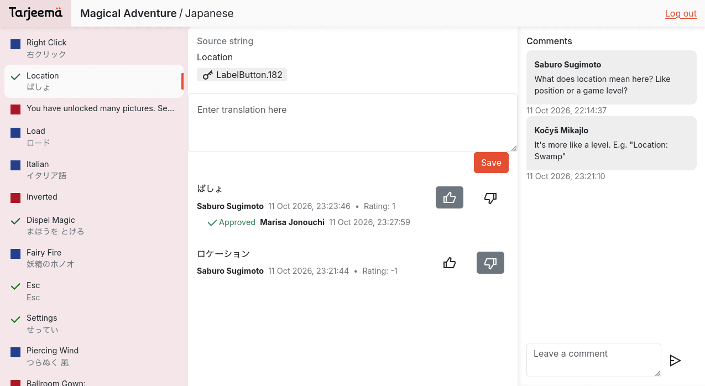
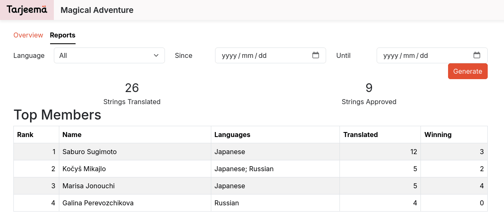
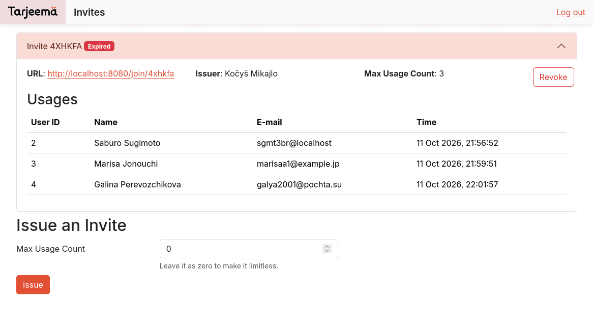

# Tarjeema

A simple app for collaborative translations inspired by Crowdin. Written in
Clojure with Ring, Reitit, Hiccup templates, and [Toucan 2][t2] for PostgreSQL.
Configuration is managed by Aero. Includes some stored procedures.

Supports importing source strings and exporting final translations as JSON
(plain key-value dictionaries).



<table>
<tr>
<td></td>
<td></td>
</tr>
</table>

Written in Spring 2025 as a university term project.

## Setting up

Before running the application, you need to start up a PostgreSQL instance and
initialize the database. The SQL code for migrations is located in `migrations`,
stored procedures are maintained in `sql`.

### 1. Initialize the schema

You can use the following general command. Adapt accordingly to your user and
database names, and add `docker exec -i CONTAINER` before `psql` if running
PostgreSQL inside Docker.

```bash
cat migrations/* sql/* | psql
```

### 2. Set up the languages

Then, you need to register languages you want to make possible to translate from
and to in the system. The list is decided by the administator. Languages are added
with this SQL command:

```sql
INSERT INTO languages ( bcp47 , lang_name )
VALUES ( 'en', 'English' )
     , ( 'ja', 'Japanese' )
     , ( 'ru', 'Russian' );
```

### 3. Register the admin user

Set your `DB_URI` environment variable to a valid JDBC connection string. Then,
run `clj -M` and evaluate the following (change credentials as needed):

```clojure
(require '[mount.core :as mount]
         '[tarjeema.db :as db])
(mount/start)
(db/register-user {:user-name "admin"
                   :user-email "admin@localhost"
                   :password "admin"})
```

The result for the last form will contain the ID for the newly created user.
Then, in `psql`, execute the following to give them the admin rights:

```sql
WITH new_role AS ( INSERT INTO roles ( role_name )
                   VALUES ( 'admin' )
                   RETURNING role_id )
INSERT INTO user_roles
SELECT 1 AS user_id , role_id
  FROM new_role;
```

## Running the application

With the `DB_URI` environment variable set to a valid JDBC connection string,
run the following command.

```bash
clj -M -m tarjeema.app
```

Refer to [`config.edn`](./config.edn) for more settings.

[t2]: https://github.com/camsaul/toucan2
